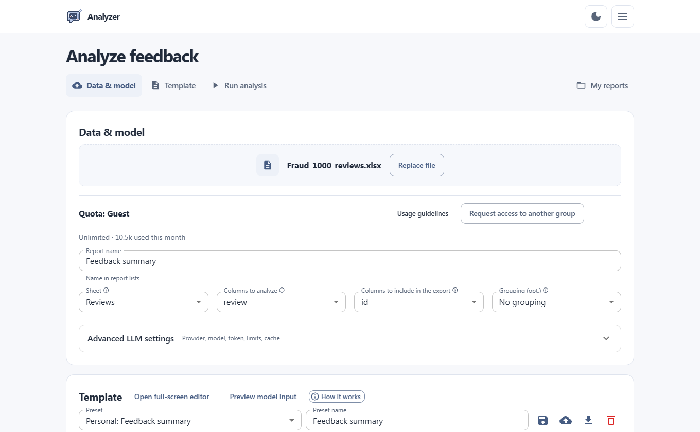
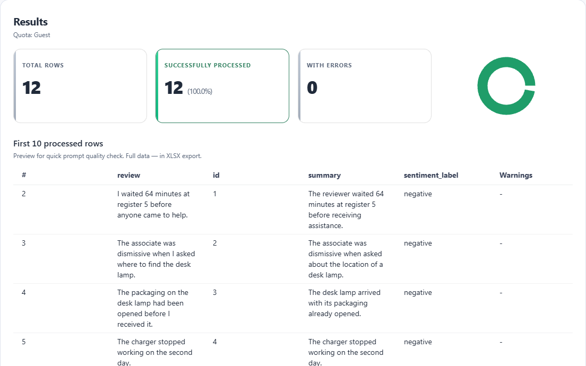

English · [Русский](README.ru.md)

<h1 align="center"> Analyzer</h1>

<p align="center"><strong>Ad hoc spreadsheet analysis with AI.</strong></p>

<p align="center">
  Classify requests, extract attributes from product descriptions, or tag records from an error log. Analyzer runs your plain-language instructions on rows or groups in an XLSX or CSV file and exports the results to Excel.
</p>

<p align="center">
  <a href="#deploy">Deploy Analyzer</a> · <a href="#run-an-analysis">Run a sample report</a> · <a href="docs/CONFIGURATION.md">Configure .env and replicas</a>
</p>



## Deploy

You need Docker with Compose and a model endpoint reachable from the containers. Analyzer supports OpenAI-compatible HTTP APIs and Ollama.

### 1. Prepare the checkout

```bash
git clone https://github.com/MaksimSamarin/ai-feedback-analysis.git
cd ai-feedback-analysis
cp .env.example .env
```

In PowerShell, use `Copy-Item .env.example .env` for the last command.

### 2. Fill in `.env`

Use this command to generate a random value for each secret you configure.

```sh
docker run --rm python:3.12-slim python -c "import secrets; print(secrets.token_hex(32))"
```

| Setting | Value |
| --- | --- |
| `APP_SECRET` | A long random string used to encrypt saved model API keys. Keep it when upgrading. |
| `POSTGRES_PASSWORD` | The password for the PostgreSQL account in `POSTGRES_USER`. |
| `DATABASE_URL` | Analyzer’s database connection string. With the bundled database, use `postgresql://review_analyzer:<postgres-password>@postgres:5432/review_analyzer` and insert the same password as in `POSTGRES_PASSWORD`. |

For an **OpenAI-compatible endpoint**, set `OPENAI_BASE_URL` to your endpoint base URL, with or without the trailing `/v1`. Set `OPENAI_MODELS` to its model IDs, separated by commas, and set `OPENAI_API_KEY` to the key. You can also enter the key before running an analysis. For a local endpoint that accepts requests without authentication, use a placeholder such as `local`.

For **Ollama**, set `OLLAMA_BASE_URL` and `OLLAMA_MODELS`, then select Ollama in Analyzer. On Docker Desktop, a provider running on the host is reachable at an address such as `http://host.docker.internal:11434`.

To create the first local administrator, set `BOOTSTRAP_ADMIN_USERNAME` and `BOOTSTRAP_ADMIN_PASSWORD` before the first start. Use at least eight characters, including a letter and a digit, for the password.

See the [configuration guide](docs/CONFIGURATION.md) for complete examples and the settings you can tune.

### 3. Start the services

```sh
docker compose up -d --build --wait
docker compose ps
```

Open [Analyzer](http://127.0.0.1:8080/) and check the [API health endpoint](http://127.0.0.1:8080/api/health). If the port is occupied, set `FRONTEND_PORT` in `.env` and open the new port.

Start with the six default containers and a 200 GB data disk. The [hardware and scaling guide](docs/CONFIGURATION.md#hardware-and-scaling) gives a starting resource budget and shows how to add a worker when the queue grows.

## Run an analysis

1. Sign in or create a local account. Under **Data & model**, upload a file or open **Sample files** and choose the smaller demo workbook.
2. Pick the columns that should go to the model. Use the export column selector for columns to carry through unchanged. Check the sheet and model before continuing.
3. Under **Template**, choose a preset or write a prompt and add the response fields you want, such as a summary and a sentiment label. Select **Preview model input** to review the prompt, selected data, and response schema.
4. For the first run, open **Advanced LLM settings** and set **Review limit** to a small number such as 12. Select **Start a new analysis**. Follow progress in **My reports**, open the result, and download the Excel file.

Use a grouping column when several rows describe one unit, such as a store shift. Analyzer sends one request per group and returns one result row per group.



## Administration

- **Language.** English is the default. In **Administration → Settings**, choose English or Russian. This setting controls the interface, built-in prompts, and demo files. Analyzer keeps the language selected for each report when retrying or resuming it. Your prompt and selected source data keep their original language.
- **Models.** Environment variables seed the model catalog once. Use **Administration → Models** to manage it after the first start.
- **Access.** Local sign-in and registration are available by default. Administrators can manage groups, quotas, and access requests. An external OIDC provider can connect a directory such as Active Directory. [Sign-in and OIDC setup](docs/AUTHENTICATION.md)

## Upgrade an existing installation

Back up PostgreSQL and the upload and results volumes. Stop the existing services with `docker compose stop`. Keep the Compose project name, volume mappings, database credentials, and `APP_SECRET`, then run the same start command from the updated checkout. Startup applies the schema migration, preserving local passwords and reports from v2.0.0.

## Reference

- [Architecture and data flow](docs/ARCHITECTURE.md)
- [Development and tests](docs/TESTING.md)
- [Release notes](docs/RELEASE_NOTES_EN.md)
- [Custom logo](branding/README.md)
- [MIT license](LICENSE)
