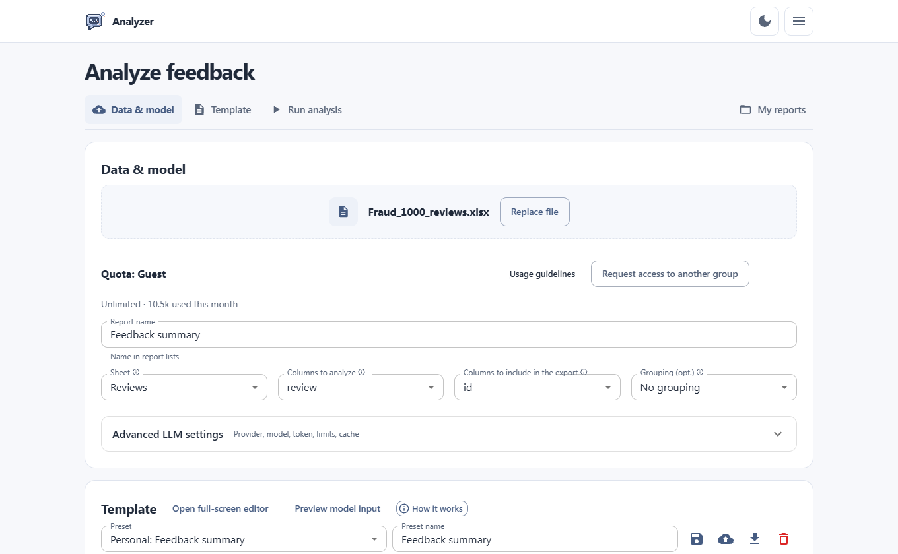
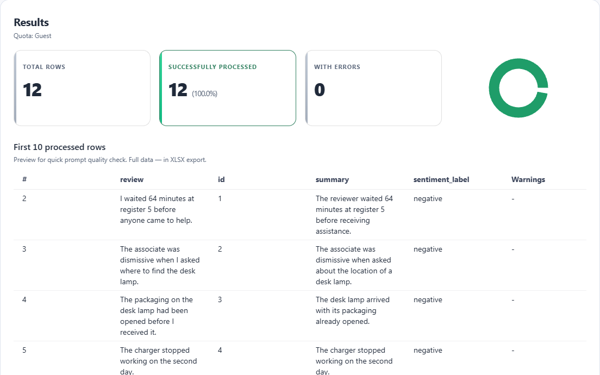

[English](README.md) · Русский

<h1 align="center"> Analyzer</h1>

<p align="center"><strong>Ad hoc аналитика таблиц с помощью ИИ.</strong></p>

<p align="center">
  Разметьте заявки по темам, извлеките характеристики из описаний товаров или классифицируйте сообщения об ошибках. Опишите задачу обычным языком. Analyzer обработает строки или группы в XLSX и CSV и выгрузит результаты в Excel.
</p>

<p align="center">
  <a href="#развёртывание">Развернуть Analyzer</a> · <a href="#первый-анализ">Запустить демо-отчёт</a> · <a href="docs/CONFIGURATION.ru.md">Настроить .env и реплики</a>
</p>



## Развёртывание

Понадобятся Docker с Compose и модель, доступная из контейнеров. Analyzer поддерживает OpenAI-совместимые HTTP API и Ollama.

### 1. Подготовьте копию репозитория

```bash
git clone https://github.com/MaksimSamarin/ai-feedback-analysis.git
cd ai-feedback-analysis
cp .env.example .env
```

В PowerShell для последнего шага используйте `Copy-Item .env.example .env`.

### 2. Заполните `.env`

Используйте эту команду для генерации отдельного случайного значения для каждого секрета.

```sh
docker run --rm python:3.12-slim python -c "import secrets; print(secrets.token_hex(32))"
```

| Параметр | Значение |
| --- | --- |
| `APP_SECRET` | Длинная случайная строка для шифрования сохранённых API-ключей моделей. Сохраняйте её при обновлении. |
| `POSTGRES_PASSWORD` | Пароль пользователя PostgreSQL, указанного в `POSTGRES_USER`. |
| `DATABASE_URL` | Строка подключения Analyzer к базе. Для базы из Compose используйте `postgresql://review_analyzer:<postgres-password>@postgres:5432/review_analyzer` и подставьте пароль из `POSTGRES_PASSWORD`. |

Для **OpenAI-совместимого API** укажите базовый адрес в `OPENAI_BASE_URL`, с окончанием `/v1` или без него. В `OPENAI_MODELS` перечислите идентификаторы моделей через запятую. Ключ можно задать в `OPENAI_API_KEY` или ввести перед анализом. Для локального API без аутентификации укажите непустое значение, например `local`.

Для **Ollama** заполните `OLLAMA_BASE_URL` и `OLLAMA_MODELS`, затем выберите Ollama в Analyzer. В Docker Desktop сервис на хосте доступен по адресу вроде `http://host.docker.internal:11434`.

Для первого локального администратора задайте `BOOTSTRAP_ADMIN_USERNAME` и `BOOTSTRAP_ADMIN_PASSWORD` до запуска. Пароль должен содержать минимум восемь символов, включая букву и цифру.

Готовые примеры и значения параметров приведены в [гайде по настройке](docs/CONFIGURATION.ru.md).

### 3. Запустите сервисы

```sh
docker compose up -d --build --wait
docker compose ps
```

Откройте [Analyzer](http://127.0.0.1:8080/) и проверьте [состояние API](http://127.0.0.1:8080/api/health). Если порт занят, задайте `FRONTEND_PORT` в `.env` и откройте новый порт.

На старте используйте шесть контейнеров из стандартного Compose и заложите 200 ГБ под данные. Стартовые лимиты и команду добавления воркера см. в [гайде по железу и масштабированию](docs/CONFIGURATION.ru.md#железо-и-масштабирование).

## Первый анализ

1. Войдите или создайте локальный аккаунт. В разделе **Данные и модель** загрузите файл или откройте **Примеры файлов** и выберите небольшую демо-таблицу.
2. Выберите колонки для модели. В список колонок итоговой выгрузки добавьте данные, которые нужно перенести в Excel без обработки. Проверьте лист и модель.
3. В разделе **Шаблон** выберите пресет или напишите свой промпт и задайте поля ответа, например краткое описание и тональность. Откройте **Показать, что уйдёт в модель**, чтобы проверить промпт, данные и схему ответа.
4. Для первого запуска откройте **Продвинутые настройки LLM**, задайте небольшой **Лимит отзывов**, например 12, и нажмите **Запустить новый анализ**. Следите за прогрессом в **Мои отчёты**, откройте результат и скачайте Excel.

Выберите колонку группировки, если несколько строк относятся к одному объекту, например к смене магазина. Analyzer отправит один запрос на группу и вернёт одну строку результата на группу.



## Администрирование

- **Язык.** По умолчанию используется английский. В **Administration → Settings** выберите русский или английский. Настройка применяется к интерфейсу, встроенным промптам и демо-файлам. При повторе или возобновлении отчёта Analyzer использует язык, выбранный при его запуске. Пользовательские промпты и выбранные данные сохраняют исходный язык.
- **Модели.** Переменные окружения заполняют каталог при первом запуске. После этого управляйте им в **Администрирование → Модели**.
- **Доступ.** По умолчанию доступны локальный вход и регистрация. Администратор управляет группами, квотами и заявками. Через внешний OIDC-провайдер можно подключить каталог, например Active Directory. [Настройка входа и OIDC](docs/AUTHENTICATION.md)

## Обновление существующей установки

Сделайте резервную копию PostgreSQL и томов с загрузками и результатами. Остановите сервисы через `docker compose stop`. Сохраните имя Compose-проекта, привязки томов, параметры базы и `APP_SECRET`, затем повторите команду запуска из обновлённой копии. Миграция схемы выполняется при старте. Локальные пароли и отчёты из v2.0.0 сохраняются.

## Документация

- [Архитектура и поток данных](docs/ARCHITECTURE.md)
- [Разработка и тесты](docs/TESTING.md)
- [Заметки о релизах](docs/RELEASE_NOTES.md)
- [Свой логотип](branding/README.md)
- [Лицензия MIT](LICENSE)
