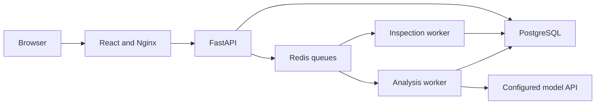

# Architecture

## From file to report

1. The API accepts an XLSX or CSV upload at `POST /api/file/inspect` and puts an inspection job in Redis. The inspection worker reads the sheets and columns and stores their metadata in PostgreSQL. The UI polls the inspection status.
2. A user selects columns, a model, and a response schema. **Preview model input** renders the same prompt and schema the worker will use. Starting an analysis creates a report, records its language, and queues it.
3. The analysis worker reads the file in batches, constructs model requests, validates JSON responses, and saves results and progress in PostgreSQL. The UI polls the report state and reads completed rows for its preview.
4. Final and interim exports read the stored rows. Excel includes the requested response fields and selected source columns. Raw JSON is available when enabled for the report.

### Analysis modes

- **By row.** One input row is sent per request. The selected analysis columns are serialized as JSON and inserted into the prompt. Output fields are defined by the response schema.
- **By group.** Rows with the same group key share one model request. The preview and Excel export include one result per group. The grouping column can be carried into the export.

If validation fails, a retry can include the validation error and a shortened copy of the previous response. The report keeps its original prompt language on resumption and retry.

## Storage and recovery

| Store | Contents |
| --- | --- |
| PostgreSQL | Accounts, sessions, access policies, model catalog, reports, results, and the model response cache. |
| Redis | Analysis and inspection queues, job leases, deduplication markers, and OIDC sign-in state. |
| Upload and results volumes | Source files, final results, and cached interim exports. |

The analysis worker can recover stale queued or running reports. A report paused by a quota retains the results already saved. When report cleanup is enabled, `REPORT_KEEP_LAST` sets the number of recent reports to keep per user. Cleanup skips older reports that are still queued, running, or paused.

The exact cache keys include model, prompt, language, schema, and selected input. Semantic matching also requires a configured embeddings provider. Cached responses are validated against the schema before reuse.

## Configuration

The administrator's interface language is stored in PostgreSQL. Clients read it from `GET /api/ui/settings`. Only an administrator can update it.

Compose serves the UI and API through a single Nginx port. If you change `MAX_UPLOAD_SIZE_MB`, check the corresponding `client_max_body_size` in [the Nginx configuration](../frontend/nginx.conf). Allow enough room for multipart request overhead.

Separate inspection and analysis workers can be scaled independently. Account for the model provider's rate limits and PostgreSQL connections when adding replicas. [Hardware and scaling](CONFIGURATION.md#hardware-and-scaling)
